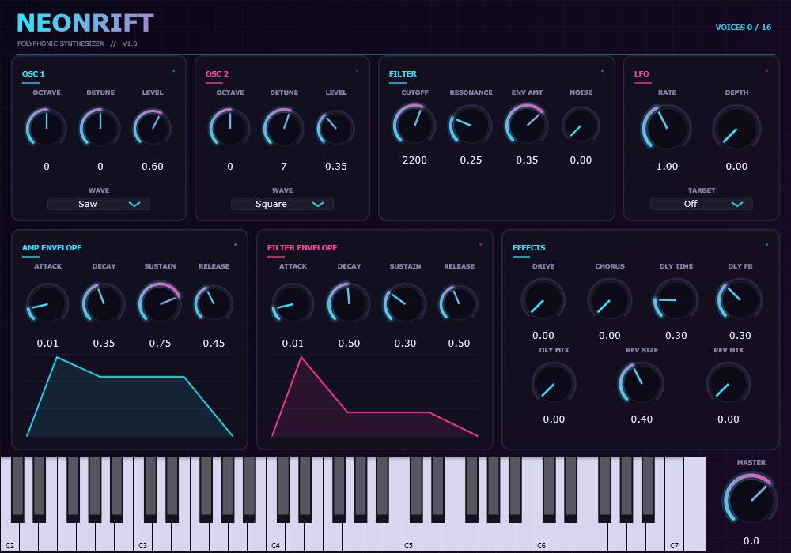

# NeonRift

霓虹赛博风格的复音减法合成器，VST3 插件 + 独立运行版（Windows x64）。



- **引擎**：16 复音，双振荡器（PolyBLEP 抗混叠：锯齿/方波/三角/正弦）+ 噪声
- **滤波**：12 dB/oct 共振低通（TPT 状态变量滤波器），带独立 ADSR 包络
- **包络**：音量 ADSR、滤波 ADSR，界面实时画出包络曲线
- **LFO**：可指向 滤波 / 音高 / 音量
- **效果**：Drive → Chorus → Ping-pong Delay → Reverb
- **界面**：深色霓虹风，自绘发光旋钮，内置可弹奏的钢琴键盘，参数悬停提示
- **参数**：31 个，全部支持 DAW 自动化与工程保存

---

## 一、构建

需要：Visual Studio（C++ 工具集）、CMake ≥ 3.22、Python 3（仅首次下载 JUCE 用）。

```powershell
# 首次：下载 JUCE 到 external/（约 60 MB）
python tools\fetch_deps.py

# 构建（增量构建很快，全量约 5–8 分钟）
powershell -File tools\build.ps1
```

产物在 `dist\`：

| 文件 | 用途 |
|---|---|
| `dist\NeonRift.vst3` | 给 DAW 用 |
| `dist\NeonRift.exe` | 独立运行，双击即可弹 |
| `dist\NeonRift-demo.wav` | 离线渲染的示范音频（琶音 + 和弦） |

> 注：本项目用 **NMake** 而不是 Ninja。Ninja 在当前环境（沙箱）里会因管道限制卡死，NMake 直接驱动 `cl.exe`，稳定可用。

## 二、装进 FL Studio

```powershell
powershell -File tools\install.ps1
```

脚本会请求管理员权限，把插件复制到 `C:\Program Files\Common Files\VST3`。

然后：

1. `Options → Manage plugins`
2. 勾选 `Verify plugins`，点 `Find more plugins`
3. 在 `Installed → Generators` 里找到 **NeonRift (VST3)**
4. 拖到通道机架，用钢琴卷帘画音符即可

## 三、第一次调出好听的音色

1. 先把 **FILTER → CUTOFF** 拧到 `800` 左右，**RESONANCE** 到 `0.35`
2. **FILTER ENV → ENV AMT** 拧到 `0.55`，弹低音 → 经典的"哇"出来了
3. **OSC 2 → DETUNE** 给 `7` 左右，两路振荡器错开 → 声音变厚
4. 想要空间感：**EFFECTS → DLY MIX** `0.2`、**REV MIX** `0.25`
5. 想要脏一点：**DRIVE** `0.3`

## 四、参数

| 区域 | 参数 | 范围 / 说明 |
|---|---|---|
| OSC 1 / 2 | WAVE | Saw / Square / Triangle / Sine |
| | OCTAVE | -2 ~ +2 |
| | DETUNE | ±50 音分 |
| | LEVEL | 该振荡器音量 |
| FILTER | CUTOFF | 20 Hz – 20 kHz（对数） |
| | RESONANCE | 0 – 1，越大越"哇" |
| | ENV AMT | 滤波包络深度，可负 |
| | NOISE | 噪声量 |
| AMP ENVELOPE | A / D / S / R | 0.001–4 s / 0.005–4 s / 0–1 / 0.005–6 s |
| FILTER ENVELOPE | A / D / S / R | 同上（作用于截止频率） |
| LFO | RATE / DEPTH / TARGET | 0.05–20 Hz；目标 滤波/音高/音量 |
| EFFECTS | DRIVE | tanh 软失真 |
| | CHORUS | 合唱深度 |
| | DLY TIME / FB / MIX | 0.05–1.5 s，反馈 0–0.9 |
| | REV SIZE / MIX | 混响大小与混合 |
| MASTER | 增益 | -24 ~ +12 dB |

**快捷操作**：旋钮上右键/双击可输入数值；鼠标悬停显示参数名；滚轮微调。

## 五、信号流

```
OSC 1 ─┐
OSC 2 ─┼→ 低通滤波(TPT SVF) → 音量包络 → DRIVE → CHORUS → DELAY → REVERB → MASTER
NOISE ─┘         ↑
         滤波包络 + LFO
```

## 六、项目结构

```
NeonRift/
├── CMakeLists.txt           # 插件 + 测试 + 编辑器的构建定义
├── Source/
│   ├── NeonRiftParameters.h # 31 个参数（ID、范围、默认值、显示格式）
│   ├── SynthEngine.h/.cpp   # DSP：PolyBLEP 振荡器、SVF、ADSR、复音、效果
│   ├── PluginProcessor.*    # VST3 外壳：MIDI、参数树、状态存取
│   ├── PluginEditor.*       # 界面布局、包络曲线、键盘
│   └── NeonLookAndFeel.h    # 霓虹外观（发光旋钮）
├── tests/
│   ├── RenderTest.cpp       # 离线渲染 + 断言（不开 DAW）
│   └── EditorTest.cpp       # 构建编辑器、截图、销毁（发现过一个崩溃 bug）
├── tools/
│   ├── fetch_deps.py        # 下载 JUCE
│   ├── fetch_pluginval.py   # 下载插件验证器
│   ├── analyze_demo.py      # 示范音频的频谱检查
│   ├── build.ps1            # 一键构建
│   └── install.ps1          # 安装到系统 VST3 目录
└── external/                # JUCE 等依赖（不纳入版本管理）
```

## 七、实现细节

- **抗混叠**：锯齿/方波用 PolyBLEP 修正；正弦用查表外的精确 `sin`，三角波谐波衰减快（1/n²），不修正也可接受。
- **滤波器**：Zavalishin TPT SVF，截止频率每 16 采样更新（`tan` 只在控制率调用），调制平滑且省 CPU。
- **复音**：同音重触发；超过 16 音时偷最老的声部；支持 CC64 延音踏板、CC123 全音符关闭。
- **参数**：`AudioProcessorValueTreeState`，自动化/撤销/工程保存开箱即用；状态以 XML 存进工程。
- **效果**：`juce::dsp::Chorus`、自写乒乓延迟（交叉反馈）、`juce::dsp::Reverb`。
- **界面**：纯代码绘制，无图片资源；`LookAndFeel` 里画发光圆弧旋钮；包络曲线直接读参数实时重绘。

## 八、验证

```powershell
# 离线音频检查（静音/出声/NaN/滤波亮度/释放衰减/16 复音）
build-nmake\NeonRiftRender_artefacts\Release\NeonRiftRender.exe

# 频谱检查示范音频
python tools\analyze_demo.py dist\NeonRift-demo.wav
```

`pluginval`（VST3 官方验证器）strictness 8 全部通过：扫描、冷/热加载、编辑器、参数自动化、总线布局、参数模糊测试。

## 九、已知限制

- 单滤波器、无调制矩阵（v1 精简版范围）
- 无预设浏览器（用 DAW 自己的预设保存）
- 不支持 MPE / 触后
- 仅 Windows x64；界面固定 1000×700，不随窗口缩放

## 十、许可

- 本仓库代码：MIT
- JUCE 9：AGPLv3 或商业授权。对外分发编译产物前，请确认遵守 AGPL（公开源码）或购买 JUCE 商业许可。
